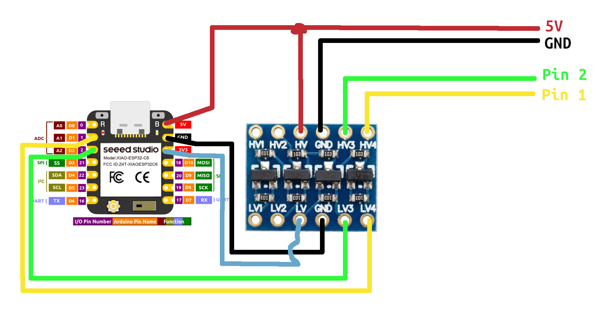

# Samsung Washer Monitor for ESPHome

Local ESPHome monitoring for Samsung washers. An ESP listens to the panel/main-board UART. No Samsung cloud account, no replacement of the original washer firmware.

Two control boards are supported, selected with `model`:

| Board (`model`) | Washer | Tested by | Example config |
| --- | --- | --- | --- |
| **DC92-01950B** (default) | WW11BGA046 | me | [`washer.yaml`](firmware/washer.yaml), [`washer-thread.yaml`](firmware/washer-thread.yaml) |
| **DC92-02395A** | WF45R6100AP/US | [@eyal0](https://github.com/eyal0) | [`washer-dc92-02395a.yaml`](firmware/washer-dc92-02395a.yaml) |

The [DC92-01950B parts catalog](https://www.sos-parts.com/display-card-original-control-unit-samsung-dc92-01950b-133080.html) lists that panel in **80 regional washer variants**, so this may also work with other machines using the same panel. Each board has only been tested on the one washer listed.

**Receive-only:** this cannot start, stop or change a wash remotely.

**Experimental DIY project:** tested on two washers, not a qualified or plug-and-play retrofit. Read [Safety](#safety) before attempting any hardware work.

## What you get


The actual Home Assistant device-page **Sensors** card from my DC92-01950B washer, with the entity icons configured in this project. **Demo values:** selections and indicators replayed from my washer's recorded history; cycle status is simulated, not a live reading.

Both boards:

- Program, temperature, spin and rinse selections.
- Displayed time, including Delay End.
- **Cycle status:** `Running`, `Paused`, `Completed`, `Off`, `Unknown`.
- Door-lock indicator, a UART-link diagnostic, plus an optional raw-capture switch.
- An optional Android progress/countdown and wash-finished notification through Home Assistant.

Board-specific:

- **DC92-01950B:** option selection, plus Panel-on, Bubble Soak and Easy Iron indicators.
- **DC92-02395A:** soil selection, plus child-lock, Steam, Pre Soak, delay and alarm indicators.

Config validation rejects entities the selected `model` cannot fill.

These are panel readings, not measured water temperature, drum speed or wash stages. The door-lock entity reports the panel's door-lock indicator.

On DC92-01950B, Running needs a captured Start event and blink confirmation. On DC92-02395A, Running is the status light blinking, and Paused needs a blink first. After a reboot or UART loss, status stays Unknown until fresh evidence arrives. Other selections can retain stale values; check UART link and device availability. Completion has natural-finish capture evidence, but cancellation, errors and other programs need more testing.

## Photos (DC92-01950B)

The photos, pinout and wiring below are from my DC92-01950B washer. For DC92-02395A, see [DC92-02395A wiring](#dc92-02395a-wiring).


**This is the correct control-panel layout for DC92-01950B**, tested on my WW11BGA046. Use it as a visual reference, and check the installed board is **DC92-01950B**; appearance alone does not confirm compatibility.


## Connector pinout (DC92-01950B)

The photo above marks **CN803** (main harness) and **CN201** (programming header). **In this vertical photo, the top pin of each connector is pin 1**, with numbering increasing downward: CN803 pins 1–8 and CN201 pins 1–4. The small arrows on the PCB mark pin 1; check those marks on your own board rather than relying on cable orientation. In my harness, the white conductor identifies CN803 pin 1.

### CN803

| Pin | Reference signal | My checks / monitor connection |
| --- | --- | --- |
| 1 | MAIN_UI_RX | UART captured; 5 V→3.3 V level translation to ESP GPIO1 |
| 2 | MAIN_UI_TX | UART captured; 5 V→3.3 V level translation to ESP GPIO2 |
| 3 | RESET | Not verified; leave untouched |
| 4 | 5 V | Continuity to CN201 pin 1 |
| 5 | SGND | Ground; continuity to CN201 pin 2 |
| 6 | 12 V | Not used by the monitor; exact pin assignment not independently verified |
| 7 | N/C | Not verified; leave untouched |
| 8 | POWER_BUTTON | Pressing Power connects it to pin 5 |

Reference: [Samsung WW6000T service manual, §5-3 “DISPLAY PCB (5000_UI)”](https://manuals.plus/m/f48da46b4831fc53fcb9898bab72945a4b6ee0bb1638cdc777d67fa09850af2a.pdf), with [UART and 5 V/12 V supply description on printed p. 87 / viewer p. 90](https://www.manualslib.fr/manual/406510/Samsung-Ww1-T-Serie.html?page=90). The reference pin labels above were supplied during the original research; the full numbered diagram could not be independently reopened.

**My experiments match the UART connections, 5 V/ground continuity and power-button contact in this reference pinout.** This does not confirm the remaining pin functions or establish mains isolation. The RX/TX names are Samsung's reference labels; both ESP connections are receive-only.

### CN201

| Pin | My board |
| --- | --- |
| 1 | 5 V; same rail as CN803 pin 4; used to power my ESP |
| 2 | Ground; same as CN803 pin 5 |
| 3–4 | Unidentified programming/debug signals; not connected to the monitor |

These power/ground assignments come from my continuity and operating-voltage checks. No programming/debug protocol was confirmed.

### My very professional installation


I just used Scotch tape to stick the ESP into an empty space. Budget engineering at its finest. Poor installation? Absolutely :D I power it from the **5 V supply on the panel's programming port (CN201)**.

> [!WARNING]
> **Not recommended:** the resistor voltage dividers in the photo above and the diagram below are just my prototype hack. Use a proper **5 V→3.3 V UART level shifter** instead ([wiring](#level-shifter-wiring)).

The resistors in the wiring photo are **voltage dividers for the washer's 5 V UART signals**, using **10 kΩ and 20 kΩ**. My multimeter's resistance range was broken, so I stuck with 10 kΩ resistors: each 20 kΩ leg is simply two 10 kΩ resistors in series. That's why there are so many resistors in the photo!

Each UART signal has its **own** divider, wired like this:

```text
Samsung UART ── 10 kΩ ──┬── ESP UART RX
                       │
                      20 kΩ
                       │
Samsung ground ────────┴── ESP GND
```

Repeat for **CN803 pin 1 → GPIO1** and **CN803 pin 2 → GPIO2**; do not join the two signal lines. Ground is **CN803 pin 5 / CN201 pin 2**. At nominal 5 V, this divider produces about **3.33 V**; verify actual signal levels and resistor tolerances against your ESP's input limits before use.

> [!IMPORTANT]
> **If you build this yourself, prefer a proper 5 V→3.3 V UART level shifter rather than copying the resistor dividers.** Wiring for one is in [Level shifter wiring](#level-shifter-wiring). I used dividers because I already had 10 kΩ resistors on hand and only needed 9600 baud receive. A passive divider has real limitations:
> - **Tight voltage margin:** 10 kΩ / 20 kΩ turns 5.00 V into ~3.33 V, leaving little headroom if the washer's 5 V rail runs high or resistor tolerances shift the ratio.
> - **Power-off / back-powering behavior:** if the washer drives UART high while the ESP is unpowered, current can flow into the ESP input protection network.
> - **Higher source impedance:** resistor dividers and wiring capacitance slow signal edges and reduce noise margin compared with a level shifter.
> - **Receive-only (`5 V → 3.3 V`):** a passive divider only steps voltage down; it cannot step a 3.3 V ESP TX output up to 5 V.

This is my prototype, not a recommended permanent mounting method or a qualified wiring guide.

### Level shifter wiring

CN803 pins 1 and 2 are a **5 V TTL UART** (8N1). DC92-01950B runs at 9600 baud. DC92-02395A runs at 38400 baud and carries the same two streams on CN3: **pin 4** in place of CN803 pin 1 and **pin 3** in place of CN803 pin 2; see [DC92-02395A wiring](#dc92-02395a-wiring). ESP32 GPIO is **3.3 V** and is not 5 V tolerant. The proper way to connect them is a **bidirectional logic level shifter** on each UART line, with the washer signals on the shifter's 5 V side.

The panel also supplies 5 V on CN803 pin 4, the same rail as CN201 pin 1. The ESP `5V` pin takes that rail, which is how the board is powered once it is installed. USB flashing still requires every washer lead to be disconnected first; see [Safety](#safety).

#### Circuit diagram

The diagram below shows a Seeed Studio XIAO ESP32-C6 with a 4-channel bidirectional level shifter. The same wiring applies to other ESP boards: use that board's `5V`, `GND` and `3V3` pins and two UART RX pins, and match the RX pins in your ESPHome YAML.



#### Wiring

| Washer (5 V side) | Level shifter | XIAO ESP32-C6 (3.3 V side) | Notes |
| --- | --- | --- | --- |
| 5 V, CN803 pin 4 or CN201 pin 1 | HV | 5V | Red. Powers the shifter HV rail and the ESP |
| Ground, CN803 pin 5 or CN201 pin 2 | GND (HV and LV) | GND | Black. Common ground |
| — | LV | 3V3 | Light blue. 3.3 V reference for the shifter LV rail |
| CN803 pin 1 | HV4 ↔ LV4 | D1 (GPIO1) | Yellow. Washer UART shifted down to 3.3 V |
| CN803 pin 2 | HV3 ↔ LV3 | D2 (GPIO2) | Green. Washer UART shifted down to 3.3 V |

`HV1`/`LV1` and `HV2`/`LV2` are unused and can be left open. Leave the other CN803 pins unconnected.

**HV** is the high-voltage supply and the reference for a logic high on the washer side. **LV** connects to the ESP `3V3` pin, which sets the logic high on the ESP side. The ESP itself is powered from its `5V` pin. Both **GND** pins share the washer ground, so the two sides have a common return.

Each numbered pair is one channel: `HV3` with `LV3`, and `HV4` with `LV4`. A high on the HV pin of a channel comes out as a 3.3 V high on its LV pin, and a low comes out as a low. The channel is bidirectional, so a signal driven into the LV pin is shifted up to 5 V on the HV pin. This firmware only receives, so both channels run from the washer into ESP RX pins.

CN803 pin 1 is the UART the component decodes. CN803 pin 2 is the optional raw-diagnostic UART. The diagram uses the same pins as the [example configuration](firmware/washer.yaml): pin 1 on **GPIO1** and pin 2 on **GPIO2**. On this XIAO those are **D1** and **D2**. On another board, set `cn803_pin1_rx_pin` and `cn803_pin2_rx_pin` to the GPIOs you actually wired.

## DC92-02395A wiring

Reported by [@eyal0](https://github.com/eyal0) in [#3](https://github.com/kralonur/samsung-washer-monitor-esphome/issues/3) for his WF45R6100AP/US; not verified by me. The board is shown on [page 36 of the WF45R6100AP/US service manual](https://www.manualslib.com/manual/3313659/Samsung-Wf45r6100ap-Us.html?page=36#manual).


**This is the control-panel layout for DC92-02395A**, photographed by @eyal0 on his WF45R6100AP/US. Use it as a visual reference, and check the installed board is **DC92-02395A**; appearance alone does not confirm compatibility.

- **UART:** the two signals are on the connector labelled **CN3**. **CN3 pin 4** carries the decoded stream (all readings) and goes to GPIO1; **CN3 pin 3** carries the raw-diagnostics stream and goes to GPIO2. Both run at **38400 baud**, 8N1.
- **Power:** take 5 V from **CN6** only. Ground is common to CN3, CN5, CN6 and CN7, but the 5 V on CN5 and CN7 is a separate rail; powering the ESP from it made the washer's speaker misbehave and the ESP brown out and reboot.

To reach the board, remove the control panel from the washer and release the clips on its back (marked below; there may be a couple more):


With the cover off, the board sits under a white plastic shield. **Leave the shield in place**: it snaps directly onto the display, and removing it risks cracking the screen. The connectors are reachable without removing it:


CN6 had no header fitted, so @eyal0 added a spare connector rather than using jumper wires. He back-probed CN3 and insulated it with Kapton tape; the green wire is RX (pin 4) and the yellow wire is TX (pin 3):


The same 5 V→3.3 V level-translation requirement applies. A level shifter matters more here: 38400 baud leaves a resistor divider far less margin than 9600.

## Hardware tested

- **Control/display panels:** Samsung **DC92-01950B** (WW11BGA046, mine) and **DC92-02395A** (WF45R6100AP/US, [@eyal0](https://github.com/eyal0)).
- **ESP board:** ESP32-C6 SuperMini on my washer.

I used an ESP32-C6, but a C6 is not required. Other ESPHome-supported ESP boards should work too, provided they have one usable UART RX channel for the readings (two if you also want CN803 pin 2 raw diagnostics, as in the example configuration). Adjust the board, framework, logger and RX pins in the configuration for your hardware; only the C6 has been tested here.

For other washers, check your installed panel and verify the electrical interface, packet format and decoded readings. Reports from other washers and ESP boards are welcome!

## Safety

> [!WARNING]
> **Before attempting this project, unplug the washing machine from the mains socket. Switching it off at the control panel is not sufficient.** Do not open the appliance or touch internal wiring while it is connected to mains power. Unplugging does not guarantee that internal capacitors have discharged; if you are not qualified to work safely on mains-powered appliances, do not proceed.

**Mains appliance: the receive interface, power arrangement and off-state behavior have not been qualified.** ESP32 GPIO is not 5 V tolerant.

Disconnect mains before changing wiring. **Disconnect every washer lead, including ground and power, before connecting USB for flashing or recovery.** Never attach USB, a PC or grounded test equipment while connected to the washer. Use the network (Wi-Fi or Thread) for logs and OTA. If you cannot establish a safe interface and enclosure, do not install this modification.

Samsung's [official English repair guide](https://downloadcenter.samsung.com/content/EU/202507/20250709163659233/Repair_Guide_Washer_English.pdf) does not qualify this modification.

## Setup

Follow the official [ESPHome installation guide](https://esphome.io/install/) and [Device Builder getting-started guide](https://esphome.io/install/getting-started/).

1. Copy the example config for your board (see the table at the top) into your Device Builder configuration directory, or add its `external_components`, `uart` and `samsung_washer` blocks to an existing ESPHome YAML. ESPHome fetches the [`samsung_washer`](components/samsung_washer/) external component from this repository automatically.
2. Add the entries from [`secrets.example.yaml`](firmware/secrets.example.yaml) to your private `secrets.yaml`. Generate an encryption key using the official [API documentation](https://esphome.io/components/api/#configuration-variables). Do not overwrite existing secrets or publish them.
3. Review the board configuration and RX substitutions. The tested wiring matches the ESP32-C6 defaults:

   | UART stream | DC92-01950B | DC92-02395A | Through 5 V→3.3 V level shifter (recommended) or tested divider to ESP |
   | --- | --- | --- | --- |
   | Readings (`uart_id`) | CN803 pin 1 | CN3 pin 4 | GPIO1 |
   | Raw diagnostics (`secondary_uart_id`) | CN803 pin 2 | CN3 pin 3 | GPIO2 |

   Both inputs use **8N1**. **DC92-01950B** uses **9600 baud**. **DC92-02395A** uses **38400 baud**. Verify connector numbering on your board; do not connect the 5 V UART signals directly to ESP GPIO. Prefer a proper 5 V→3.3 V UART level shifter over the prototype resistor dividers; see [Level shifter wiring](#level-shifter-wiring). These GPIO numbers match the diagram and [`washer.yaml`](firmware/washer.yaml).
4. In Device Builder, **Validate**, then **Install**. First USB installation requires every washer lead disconnected. Later updates can use network OTA (Wi-Fi or Thread).
5. In Home Assistant, add the **ESPHome** integration with the monitor's address and encryption key. Compare readings with the panel before building automations.

### Component configuration

The [`washer.yaml`](firmware/washer.yaml) example contains all supported entities for the DC92-01950B board. [`washer-dc92-02395a.yaml`](firmware/washer-dc92-02395a.yaml) is the same wiring with the entities that the DC92-02395A board decodes. Under `samsung_washer`:

- `model` selects the control board. `DC92-01950B` (the default) is the 32-byte format and requires 9600 baud. `DC92-02395A` is the 33-byte format from the WF45R6100AP/US and requires 38400 baud. Both UART blocks use 8 data bits, no parity, and 1 stop bit. `dc92_02395a` is accepted as well.
- `uart_id` selects the readings UART, called the **pin 1** stream below (CN803 pin 1 on DC92-01950B, CN3 pin 4 on DC92-02395A). This stream supplies all readings.
- `secondary_uart_id` optionally selects the **pin 2** stream UART for raw diagnostics (CN803 pin 2 on DC92-01950B, CN3 pin 3 on DC92-02395A). Omit it and its UART block if you only want the decoded readings. The two UART IDs must be different and cannot be shared with another reader. Do not enable UART debug `dummy_receiver`; the component reads the bytes itself.
- Every entity block is optional. Standard ESPHome entity options such as `id`, `icon`, filters and automations remain available. Tracking does not depend on which entities you expose.
- `uart_raw_capture` adds the diagnostic switch; it defaults to off after reboot. While on, it logs the raw bytes of pin 1 (and pin 2, if `secondary_uart_id` is set) in chunks of up to 64 bytes as hex under the `washer.raw` log tag, including malformed data, without transmitting anything.
- `update_interval` defaults to `2s` and sets how often the UART link is checked. Five seconds without a valid pin 1 frame marks the link inactive and resets cycle status to Unknown. On `DC92-01950B`, a blank panel must persist for two seconds before reporting Off. On `DC92-02395A`, Off and Completed apply on the matching frame, and a blink must hold still for two seconds before the reading returns to `Paused`.

No parser header or YAML lambdas need to be copied. When updating an existing installation, remove the old `includes: washer_parser.h`, washer globals/interval, template entities and UART debug lambdas before adding the new component blocks. The example keeps the old entity names, so Home Assistant entity IDs stay the same; don't rename them if you want to keep your history and automations. The old template entities' ESPHome `id` values (such as `cycle_status` or `packet_diagnostics`) are not set by default; if your own YAML refers to them, add the `id` to the matching entity block.

### DC92-02395A readings

Byte numbers count from 0 at the `5A` header.

| Entity | Values | Source |
| --- | --- | --- |
| Cycle status | `Running` while the status light blinks; `Paused` when it holds still for two seconds after a blink; `Unknown` before the first blink (such as while choosing a cycle); `Completed` / `Off` on a blank panel with byte 29 `0x23` / `0x03` | Byte 7 bit 6, byte 29 |
| Program indicator | `Normal`, `Heavy Duty`, `Whites`, `Bedding`, `Sanitize`, `Rinse & Spin`, `Perm Press`, `Delicates`, `Quick Wash`, `Self Clean`. The lit light blinks while running; a dark frame keeps the previous program | Bits 6–7 of bytes 6, 8, 10, 12, 14 |
| Temperature selection | `Cold`, `2`, `3`, `4`, `Hot` (one to five lights, cold to hot); `No indicator` when all are dark | Bit 0 of bytes 12, 10, 8, 6, 4 |
| Rinse selection | Light count `0` to `5` | Byte 3, low 5 bits |
| Spin selection | `0`, `No Spin`, `2`, `3`, `4`, `High` | Byte 5, low 5 bits |
| Soil selection | `0`, `Light`, `2`, `3`, `4`, `Heavy` | Byte 7, low 5 bits |
| Displayed time | `H:MM`, or Delay End as `1h` to `24h`; same text as the other board | Bytes 11, 13, 15 (segments a–g in bits 0–6; a blank leading digit is zero) |
| Door lock indicator | On when set | Byte 17 bit 1 |
| Child lock indicator | On when set | Byte 17 bit 3 |
| Steam indicator | On when set | Byte 5 bit 6 |
| Pre Soak indicator | On when set | Byte 3 bit 5 |
| Delay indicator | On when set | Byte 3 bit 6 |
| Alarm | On when the sound-off LED is dark | Byte 7 bit 5 clear |

Rinse, spin and soil bars fill from bit 4 downward; a pattern that is not a solid bar is `Unknown`. Option, panel-on, Bubble Soak and Easy Iron are not decoded.

### Thread instead of Wi-Fi

The ESP32-C6 also has a Thread (802.15.4) radio. [`washer-thread.yaml`](firmware/washer-thread.yaml) is the same configuration with Wi-Fi replaced by ESPHome's [OpenThread component](https://esphome.io/components/openthread/). ESPHome cannot run Wi-Fi and Thread together on one ESP, so the API, logs and OTA updates all go over Thread. It needs an ESP with an 802.15.4 radio (ESP32-C6, C5 or H2) and a Thread border router that Home Assistant can reach.

1. Get your Thread network's active dataset as a hex TLV string. In Home Assistant, go to **Settings → Devices & services → Thread**, open your preferred network, and use its dataset/TLV option (this needs a border router that Home Assistant manages, such as the OpenThread Border Router add-on). Alternatively, run `ot-ctl dataset active -x` on an OpenThread border router.
2. Copy [`secrets-thread.example.yaml`](firmware/secrets-thread.example.yaml) to `secrets-thread.yaml` next to `washer-thread.yaml`, and put the TLV in it. Your existing `secrets.yaml` still provides the API key and OTA password; its Wi-Fi entries are unused. The dataset contains your Thread network key, so keep this file private.

   ESPHome's `!secret` only reads `secrets.yaml`, so this file is loaded with `!include` instead. As a result, ESPHome does not redact it like other secrets: `esphome config` prints the TLV, so don't share that output. Device Builder also lists `secrets-thread.yaml` as a device card; ignore that card and don't install it.
3. Validate and install `washer-thread.yaml` instead of `washer.yaml`. Then add the device in Home Assistant through the ESPHome integration, if it is not discovered automatically.

The device joins as a full Thread device (`FTD`), so it can also act as a router for your other Thread devices, since it is mains-powered.

> [!WARNING]
> Switching an installed monitor from Wi-Fi to Thread happens over the last Wi-Fi OTA update. If the Thread dataset is wrong or Home Assistant cannot reach the Thread network, the monitor drops off the network, and recovery needs USB flashing, which means disconnecting every washer lead first. Check the dataset before installing. Home Assistant also needs an IPv6 route to the Thread network, which your border router normally advertises on your LAN.

## Android notifications

The [notification blueprint](home-assistant/blueprints/washer_notification.yaml) keeps one card: estimated progress and countdown while Running, static time while Paused, and **Wash finished** on Completed. Off or unknown/unavailable status clears it. Delay End shows a scheduled-finish label rather than a progress bar.

1. Copy it to `/config/blueprints/automation/samsung_washer/washer_notification.yaml`, then reload automations.
2. Create a dedicated **Number helper**: minimum `0`, maximum `172800`, step `1`, unit `s`; leave it at zero initially.
3. Create an automation from the blueprint. Select Cycle status, Displayed time and the helper; enter your Android `notify.mobile_app_…` action and a washer dashboard/device path.

Allow Companion app notifications on the phone. Progress is estimated from the first observed running time, not actual wash stages; reaching zero does not trigger completion. See the official [Android notification documentation](https://companion.home-assistant.io/docs/notifications/notifications-basic/).

## Contributing

Report the exact model/board, expected reading and actual panel behavior. For decoding issues, turn on the **UART raw capture** switch (configured with `uart_raw_capture`), save a short **network** (Wi-Fi or Thread, not USB) log around one action, then turn capture off. Review logs and photos before sharing; never include credentials, backups or compiled firmware. Keep firmware receive-only.

### Development checks

Run from this repository's root, with a C++ compiler and ESPHome installed in the Python environment that runs the tests:

```sh
python -m unittest discover -s tests -p 'test_*.py'
g++ -std=c++17 -Wall -Wextra -pedantic firmware/test_parser.cpp -o /tmp/washer-parser-test
/tmp/washer-parser-test /dev/null 32 0
esphome compile tests/component.yaml
tests/.esphome/build/washer-component-test/.pioenvs/washer-component-test/program
```

GitHub Actions runs these checks on every pull request and on pushes to `main`. The runtime tests build against ESPHome's actual entities and filters on a Linux/macOS host, using in-memory UARTs, not the washer. They cover decoding, cycle tracking, optional/filtered entities, link loss, switch restoration and receive-only behavior. The parser test also accepts a binary capture, frame length and expected valid-frame count as arguments.

To compile `firmware/washer.yaml` against a local checkout before publishing, replace its external component source with:

```yaml
external_components:
  - source:
      type: local
      path: ../components
    components: [samsung_washer]
```

## License

Original project code and configuration are available under the [MIT License](LICENSE). ESPHome and other dependencies retain their own licenses; this does not relicense them. Distributing compiled firmware also requires complying with the licenses of its included components; this project publishes source/configuration, not firmware binaries. Linked Samsung manuals and other third-party material are not covered by this license.

Not affiliated with Samsung.
